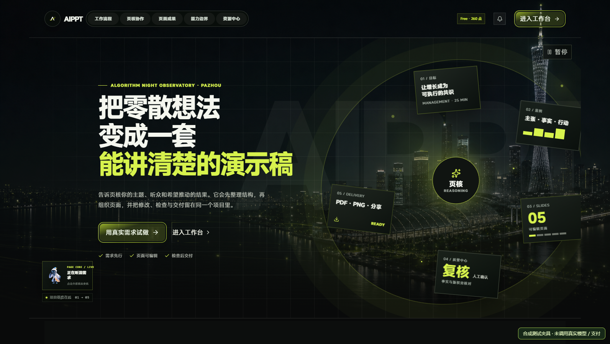
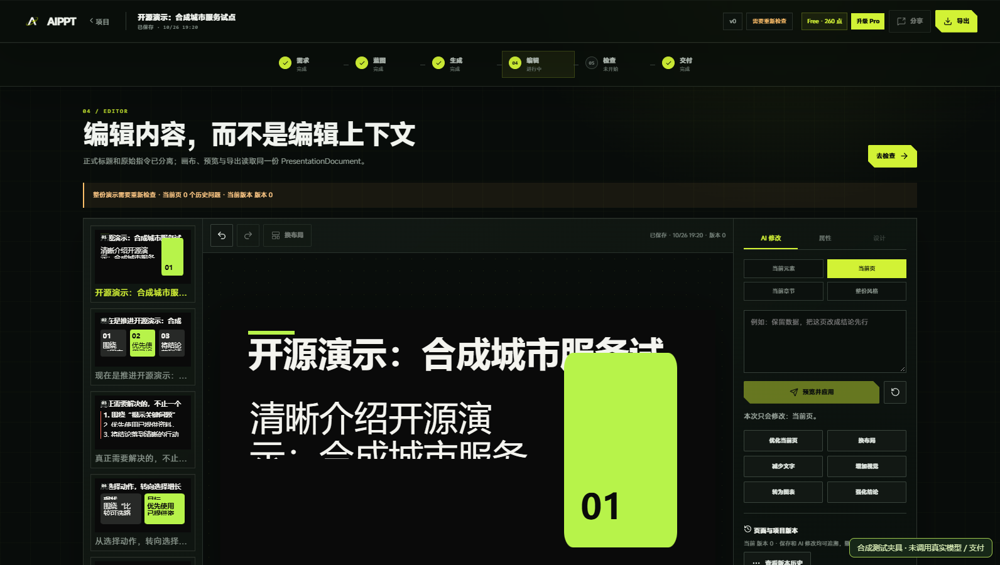

# AIPPT Studio · AI 演示工作台

把主题、资料与演示结构连接到同一个本地工作台：需求澄清、演示蓝图、生成阶段、对象编辑、质量检查和交付导出，按项目持续保存与恢复。

**开发中 / 本地 MVP**。本目录源于“AI 演示智能工作台 2.0”中的 `AIPPT_Codex_FastBuild_Package_V3.2.0`；材料包版本为 3.2.0。“工作台 3.0”另一个目录实际上是视觉组件参考画廊，不是本后端的新版本。

[在线作品展示](https://yangwei251003.github.io/aippt-studio/) · [验证与限制](docs/OPEN_SOURCE_VALIDATION.md) · [第三方许可](THIRD_PARTY_ASSETS.md) · [公开范围](RELEASE_SCOPE.md)

> GitHub Pages 是**只读作品展示**，呈现真实运行截图和启动方法，不运行模型、后端、账户或导出。完整应用按下面步骤在本地运行。截图与本次测试全部使用合成夹具，未调用真实模型、客户资料或支付。



## 核心能力

- **六阶段创作**：需求 → 蓝图 → Agent Studio → 编辑器 → 质量中心 → 交付中心；路由与数据按项目隔离。
- **原生对象编辑**：文本、形状、图表等对象模型，保存、撤销、修订号与过期结果识别。
- **多格式输入/输出**：PDF/DOCX/XLSX/PPTX 解析与检查；PPTX 原生导出，PDF/PNG 使用本地浏览器渲染；另有 HTML 与 HTML ZIP 输出实现。
- **本地存储**：PGlite 与本地对象目录；没有把个人运行数据库搬到仓库。
- **资源生态**：48 个自有模板定义、12 个声明式资源 Skill、96 个种子 SVG，以及带来源与许可字段的资源目录。
- **真实失败状态**：模型未配置会返回 `AI_MODEL_NOT_CONFIGURED`；测试 Fake 模型只允许 `NODE_ENV=test`，不会在普通生成入口悄悄替代真实模型。



## 技术栈与结构

Node.js 24+ / pnpm 10.33.2 / TypeScript；Next.js 16.4.3、React 19、Fastify 5.12.6、PGlite、Zod 4.6.6；PptxGenJS、pptx-automizer、JSZip、Reveal.js；Konva / react-konva；Sharp 0.35.5 与本地 Chromium/Edge/Chrome。版本和完整性固定于 `pnpm-lock.yaml`。

依赖审计仍保留 4 条 high 记录，均在 `pptx-automizer` 的传递依赖中；不是无漏洞认证。现有调用路径、修复范围与后续限制见 [依赖安全记录](docs/DEPENDENCY_SECURITY.md)。

```text
apps/web/                 Next.js 工作台与浏览器渲染入口
apps/api/                 Fastify API、模型适配、持久化、资源、导出
apps/worker/              可选任务进程；本地默认使用内嵌任务执行
packages/core/            对象模型、命令、蓝图、模板与资源定义
assets/                   自有源图、模板预览、种子 SVG、声明式 Skill
samples/                  合成需求与蓝图
scripts/                  资产生成、验收、包校验、SBOM 与许可归档
/tests/、各包 tests/       合成夹具与既有测试
/docs/                    原开发记录、本次验证和真实截图
licenses/                 第三方完整通知与必要原文
site/                     独立 Pages 作品展示源码
```

## 快速启动

需要 Node.js 24 或更新版本、pnpm 10.33.2；首次安装依赖需要网络。PDF/PNG 渲染需要本地 Edge/Chromium/Chrome。无需为了浏览首页而配置模型。

```sh
git clone https://github.com/yangwei251003/aippt-studio.git
cd aippt-studio
pnpm install --frozen-lockfile
pnpm --filter @aippt/core build
```

Windows PowerShell：

```powershell
Copy-Item .env.example .env
pnpm dev
```

macOS / Linux（本次未实测完整后端）：

```sh
cp .env.example .env
pnpm dev
```

打开 **http://localhost:3000**；API 健康状态为 **http://localhost:8787/health**。`pnpm dev` 同时启动 Web 与 API，并重建必要本地视觉资源。只启动 Web 会失去项目、保存和模型接口。

默认密钥留空，因此模型状态应为 `generationReady: false`，生成会明确提示未配置。要使用真实 AI，请仅在本机 `.env` 中选择项目支持的 Provider，并填入自己有权使用的模型、地址和密钥；根据模板把 `OPENAI_MODEL` 占位值替换为实际可用标识。本次没有验证任何付费模型或供应商可用性。`.env` 被 Git 忽略，不要提交它。

### PDF / PNG 浏览器

Windows 现有 Edge 路径会自动检测；若仅安装 Chrome、或需要指定其他浏览器，应把 `PLAYWRIGHT_EXECUTABLE_PATH` 设置为启动进程的环境变量，确保 Web 渲染进程能够读取。例如在 PowerShell 中先执行：

```powershell
$env:PLAYWRIGHT_EXECUTABLE_PATH = "C:\Program Files\Google\Chrome\Application\chrome.exe"
pnpm dev
```

也可仅在 `apps/web/.env.local` 中保存该本机浏览器配置。仓库根 `.env` 由 API 入口加载，不保证自动传给 Web；不要只在根文件填写浏览器路径。前端与 API 都要保持运行，后端通过前端渲染入口获得导出文件。

### 构建与测试

```sh
pnpm build
pnpm typecheck
pnpm test
pnpm test:e2e
pnpm verify:package
node --test tests/document-fixtures.test.mjs
pnpm sbom
```

浏览器 E2E 默认使用已安装 Chrome，可用 `AIPPT_BROWSER_CHANNEL` 指定 Playwright 支持的已装通道。测试使用独立合成夹具；Worker 当前没有独立测试文件。`pnpm lint` 与类型检查同为 TypeScript 检查；不把它称为额外规则体系。

本次已有：构建与类型检查通过；124 个现有单元/集成/源契约测试、11 个浏览器测试通过。导出和真实 HTTP 补充检查见 [验证记录](docs/OPEN_SOURCE_VALIDATION.md)。测试退出成功不代表真实模型质量、生产支付、云存储或所有第三方服务已接通。

## 运行数据与公开边界

运行后 `.data/` 保存项目与对象文件；删除该目录会丢失本地项目，请自行备份。仓库不附运行数据库、真实模型配置、私人演示稿、客户素材、缓存、依赖目录或旧会话截图。

旧组件参考副本、Mostar 未授权照片/字体/页面材料、完整参考文本不公开。保留自有完整业务代码和必要应用内第三方集成；React Bits、GSAP、MiSans 等有各自条件，**整个依赖栈不是纯 MIT**。自有代码和资源采用 MIT，详见 [许可边界](THIRD_PARTY_ASSETS.md)。产品内套餐、点数和商品价格是应用配置/合成测试场景；未接真实支付，也不是个人财产数据。

## 状态与后续计划

- 已验证本地基础链条、原生编辑数据契约、失败/重试、合成夹具及浏览器页面。
- 真实模型生成质量、完整 V2 工作流外部 Provider、云对象存储、生产认证与实际支付尚未在本次迁移中验证。
- 资源目录仍有参考方案的 `PENDING_AUDIT` 条目；它们不能当成上游代码已审核/已启用。
- 后续应按真实需求完成模型/生产认证、资源逐项审核与独立 Worker 可靠性验证；保持现有视觉基线。

原目录还包含未公开的数据库、私人运行产物和受限参考资料，本公开版不是全量私人资产备份，**原项目暂不可据此删除**。

## 源码归档与校验范围

Git按原始字节保存归档文件，校验清单仅覆盖实际提交的文件。Next项目的`next-env.d.ts`遵循原`.gitignore`，由首次启动或构建生成；依赖、构建缓存与本机配置不入库。
